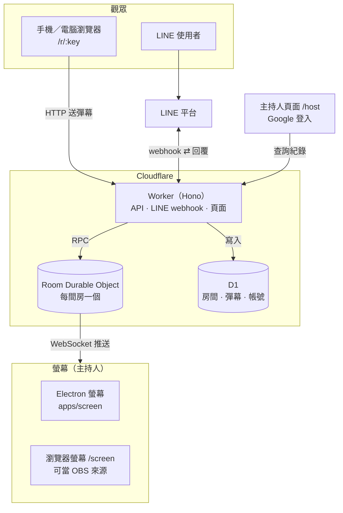

# 彈幕教室 Danmu Classroom

在課堂或活動上，讓觀眾用手機、電腦或 LINE 傳訊息，訊息會以彈幕形式飛過講者的螢幕。

這是在 Cloudflare 上的重寫版本，取代 [danmu-classroom-server](https://github.com/danmu-classroom/danmu-classroom-server)（Rails / Heroku）。

## 架構



一則彈幕的路徑：觀眾從網頁或 LINE 送出 → Worker 驗證並寫入 D1 → 交給該房間的 Durable Object → 透過 WebSocket 推到所有連線中的螢幕（沒有螢幕連線時先排隊，連上後補送）。所有連線都是「用戶端 ↔ Cloudflare」，沒有瀏覽器之間的 P2P。

圖中省略的細節：螢幕啟動時先呼叫 `POST /api/rooms` 開房；Durable Object 在開房 3 小時後以 alarm 自動關房並更新 D1；瀏覽器端的 JS 與字型由 Workers 靜態資源提供；主持人登入走 Google OAuth。

- **Worker**（`apps/worker`）：HTTP API，用 Hono 寫成。
- **Room Durable Object**：一間房一個。螢幕用 hibernatable WebSocket 連線，彈幕即時推送；沒有螢幕連線時先排入佇列，螢幕連上後補送。開房 3 小時後由 alarm 自動關房。
- **D1**：房間、彈幕紀錄、發送者（之後也存 LINE bot 的對話狀態）。房號只在「開放中的房間」之間唯一，由 partial unique index 保證。
- **`packages/shared`**：API 與 WebSocket 訊息的共用型別。
- **`packages/screen-core`**：螢幕共用程式：`ScreenConnection`（開房、WebSocket、斷線重連、房間關閉後自動開新房）、`DanmuCanvas`（彈幕繪製）與字型。
- **`apps/screen`**：Electron 螢幕（疊在簡報上的透明視窗 + 控制面板），從 [danmu-classroom-screen](https://github.com/danmu-classroom/danmu-classroom-screen) 搬入並改用 WebSocket。
- **瀏覽器螢幕** `/screen`：由 Worker 提供，背景透明，可當 OBS 瀏覽器來源；`/screen?bg=green` 可改成純色背景（綠幕去背），`?qr=0` 隱藏右下角的加入 QR code。
- **觀眾網頁** `/`、`/r/:key`：手機或電腦送彈幕。

## API

| Method | Path                                 | 說明                                                                                                                 |
| ------ | ------------------------------------ | -------------------------------------------------------------------------------------------------------------------- |
| `POST` | `/api/rooms`                         | 開房，回傳房號與 `auth_token`（只回傳這一次）                                                                        |
| `GET`  | `/api/rooms`                         | 開放中的房間                                                                                                         |
| `GET`  | `/api/rooms/:key`                    | 單一房間                                                                                                             |
| `POST` | `/api/rooms/:key/danmus`             | 送彈幕 `{ "danmu": { "content": "...", "sender": { "provider": "line", "uid": "..." } } }`                           |
| `GET`  | `/api/rooms/:key/ws?auth_token=`     | 螢幕的 WebSocket，收到 `{ "type": "danmu", "danmu": {...} }` 與 `{ "type": "room_closed" }`；送 `ping` 會收到 `pong` |
| `GET`  | `/api/rooms/:key/danmus?auth_token=` | 輪詢（相容舊版螢幕），取出並清空佇列                                                                                 |

回應格式與舊版 Rails API 相同，舊版螢幕不用改就能連。

## 開發

用 VS Code 開啟後選「Reopen in Container」（Node 24、pnpm）。

```bash
pnpm dev        # wrangler dev（本機 D1 + Durable Objects），http://localhost:8787
                # 瀏覽器螢幕：http://localhost:8787/screen
pnpm dev:screen # Electron 螢幕（連到 localhost:8787），視窗在 http://localhost:6080（noVNC，密碼 vscode）
pnpm test       # vitest，在 Workers runtime 內執行
pnpm typecheck
pnpm lint
```

## 觀眾怎麼送彈幕

- **網頁（門檻最低）**：掃螢幕上的 QR code，或打開 `/` 輸入房號，就能直接送出。不用登入；瀏覽器會產生一個匿名 ID 存在 localStorage。
- **LINE**：加入官方帳號好友後輸入房號（見下方）。

公開 API 送出的彈幕每位發送者有頻率限制（一次最多連送 3 則，之後約每秒 1 則，超過回 429），由房間的 Durable Object 計算；LINE 不受限。

## 主持人帳號

主持人用 Google 登入（`/login`），之後可在 `/host/rooms` 看自己的房間和每間房的彈幕紀錄。房間怎麼歸到帳號：

- 在已登入的瀏覽器開 `/screen`：開的房間自動歸到這個帳號。
- Electron 螢幕：控制面板按「保存到我的帳號」，會用房間的 `auth_token` 換一個 10 分鐘有效的一次性連結並開啟瀏覽器，登入後確認即可。

Session 存在 D1（只存 token 的 SHA-256），cookie 為 HttpOnly、SameSite=Lax，30 天有效；表單 POST 有 CSRF（Origin）檢查。登入方式集中在 `apps/worker/src/auth/providers.ts`，之後要加 LINE、GitHub、Microsoft 只需新增一筆設定。

本機沒有 Google client 時，可在 `.dev.vars` 設 `DEV_LOGIN=true` 使用開發用登入（只在 localhost 生效，正式環境不要設定）。

## LINE bot

對話流程與舊版相同：先按「輸入房號」→ 輸入螢幕上的房號 → 之後傳的每則訊息都會變成彈幕，並可「換個房間」或「離開房間」。對話狀態存在 D1 的 `senders`。

需要 Messaging API channel 的兩個值：

```bash
# 本機：複製範例後填入
cp apps/worker/.dev.vars.example apps/worker/.dev.vars
# 正式環境
pnpm --filter @danmu/worker exec wrangler secret put LINE_CHANNEL_SECRET
pnpm --filter @danmu/worker exec wrangler secret put LINE_CHANNEL_TOKEN
```

LINE Developers console 的 Webhook URL 設為 `https://<worker 網址>/api/line/callback`。

## 部署

正式環境：<https://danmu-classroom.danmu-worker.workers.dev>（D1 `danmu-classroom`，APAC）

- **自動**：push 到 `main` 時，GitHub Actions 跑完 lint / typecheck / test 後部署（build 瀏覽器端 JS → 套用 D1 migrations → `wrangler deploy`）。需要 repo secret `CLOUDFLARE_API_TOKEN`（Cloudflare dashboard → My Profile → API Tokens，用「Edit Cloudflare Workers」範本並加上 D1 Edit 權限）；沒設定時只跳過部署。
- **手動**（已 `wrangler login`）：`pnpm --filter @danmu/worker run deploy`

Worker secrets（在 `apps/worker` 執行 `wrangler secret put <NAME>`）：

| 名稱                                        | 來源                                                                                                  |
| ------------------------------------------- | ----------------------------------------------------------------------------------------------------- |
| `LINE_CHANNEL_SECRET`、`LINE_CHANNEL_TOKEN` | LINE Developers console（Messaging API channel 的 Channel secret 與 long-lived Channel access token） |
| `GOOGLE_CLIENT_ID`、`GOOGLE_CLIENT_SECRET`  | Google Cloud console → Credentials（Web application）                                                 |

要在外部服務設定的網址：

- LINE Developers console → Webhook URL：`https://danmu-classroom.danmu-worker.workers.dev/api/line/callback`
- Google OAuth client → Authorized redirect URIs：`https://danmu-classroom.danmu-worker.workers.dev/auth/google/callback`（本機：`http://localhost:8787/auth/google/callback`）

## 進度

- [x] M1：Worker + Room Durable Object + WebSocket、開房與房號配發、自動關房
- [x] M2：LINE bot webhook
- [x] M3：螢幕端（Electron 改用 WebSocket、瀏覽器版）
- [x] M4：觀眾網頁、主持人 Google 登入與歷史紀錄
- [x] M5：部署到 Cloudflare、CI
