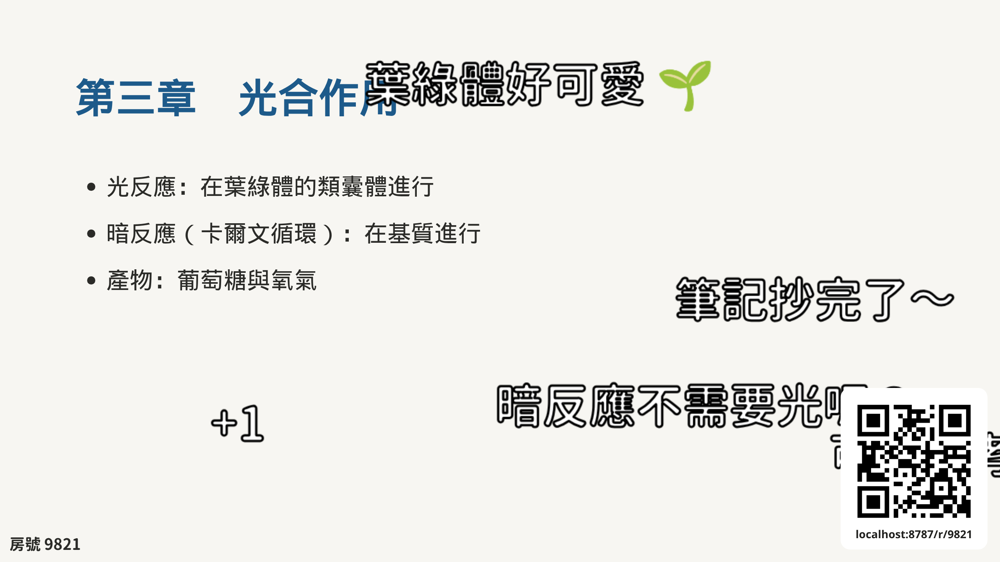
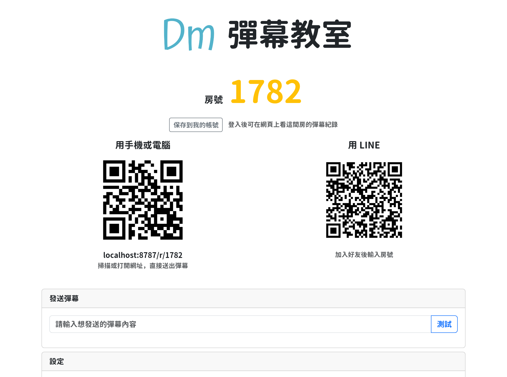
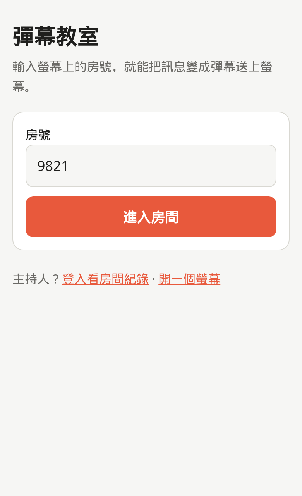
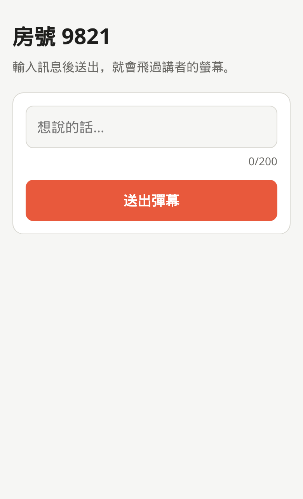
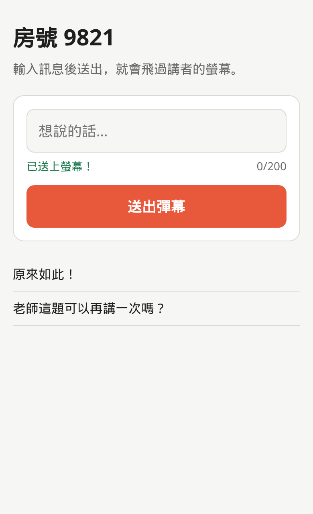
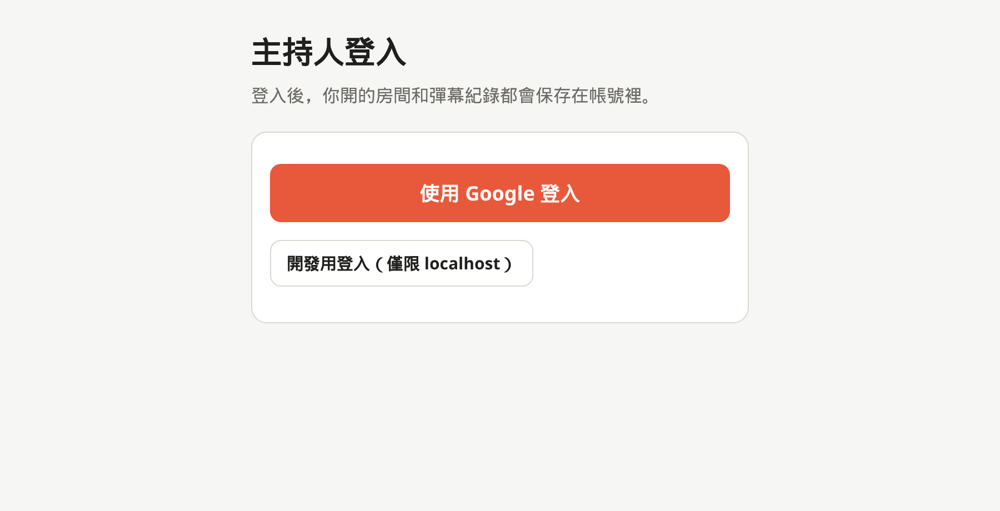
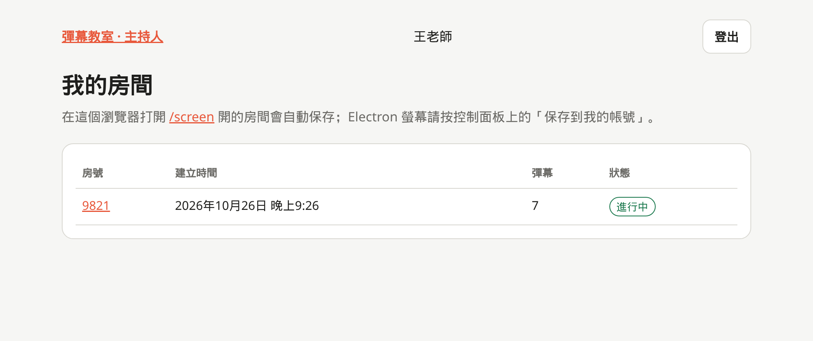
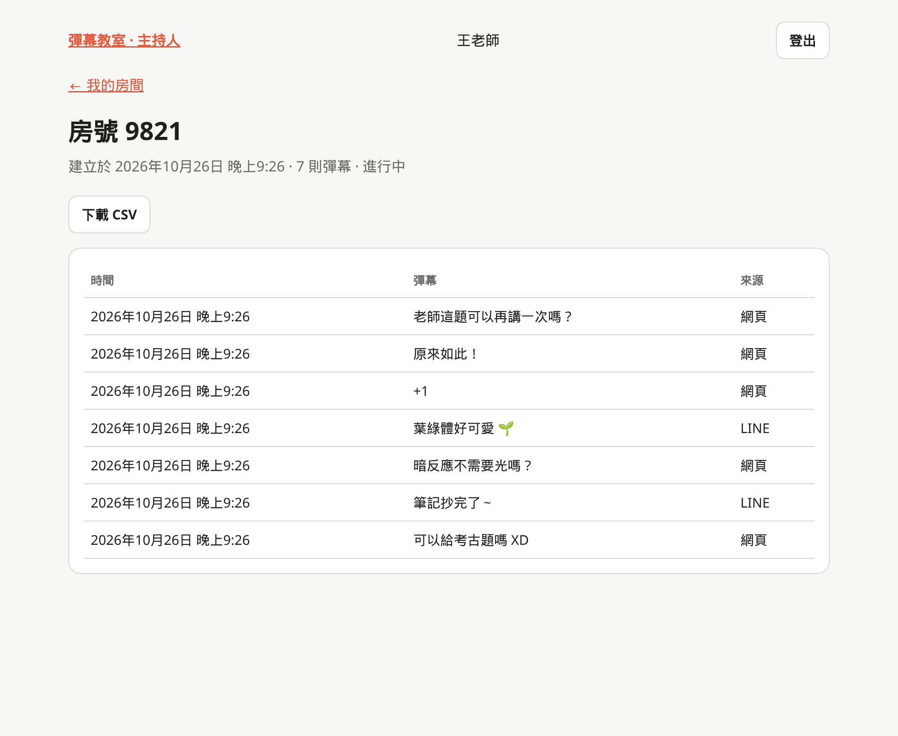

# 彈幕教室 Danmu Classroom

讓台下的人用手機、電腦或 LINE 傳訊息，訊息會變成彈幕飛過講者的螢幕。不用安裝、不用註冊，掃 QR code 就能參與。

**網站：<https://danmu-classroom.danmu-worker.workers.dev>**

- [主持人：開始上課](#主持人開始上課)
- [觀眾：送彈幕](#觀眾送彈幕)
- [主持人：課後看紀錄](#主持人課後看紀錄)
- [常見問題](#常見問題)
- [開發者文件](#開發者)

## 主持人：開始上課

### 1. 打開螢幕

兩種螢幕擇一使用，都會自動開一間房、顯示房號和加入用的 QR code：

|          | 桌面 app                                                                                                                   | 瀏覽器版                                                       |
| -------- | -------------------------------------------------------------------------------------------------------------------------- | -------------------------------------------------------------- |
| 適合     | 彈幕疊在簡報（PowerPoint、Keynote…）上方                                                                                   | 不想安裝、直播（OBS）                                          |
| 取得方式 | 到 [Releases](https://github.com/danmu-classroom/danmu-classroom/releases?q=screen-v&expanded=true) 下載最新的 `screen-v*` | 打開 <https://danmu-classroom.danmu-worker.workers.dev/screen> |

**桌面 app** 開啟後會出現控制面板，彈幕則顯示在一個透明、可穿透滑鼠的全螢幕視窗上，簡報照常操作。

| 檔案                      | 平台                        |
| ------------------------- | --------------------------- |
| `…-mac-arm64.dmg`         | Mac（Apple 晶片）           |
| `…-mac-x64.dmg`           | Mac（Intel）                |
| `…-win-x64.exe`           | Windows（免安裝，直接執行） |
| `…-linux-x86_64.AppImage` | Linux                       |

**瀏覽器版** 的背景是透明的，可以直接當 OBS 的「瀏覽器來源」。網址可加參數：

- `/screen?bg=green`：改成純色背景（綠幕去背）
- `/screen?qr=0`：不顯示右下角的 QR code

### 2. 請觀眾加入

把房號或 QR code 秀給大家看就可以了。房間會在 **3 小時** 後自動關閉，螢幕會自動換一間新房（房號會變）。

> 想保存彈幕紀錄的話，先用瀏覽器[登入](#主持人課後看紀錄)：在登入過的瀏覽器開的螢幕會自動存到你的帳號；桌面 app 則按控制面板上的「保存到我的帳號」。

## 觀眾：送彈幕

### 用網頁（最簡單）

1. 用手機掃螢幕上的 QR code，或打開 <https://danmu-classroom.danmu-worker.workers.dev> 輸入房號
2. 輸入想說的話，按「送出彈幕」

  
  
  

不用登入。同一個人送太快會被暫時擋下（一次最多連送 3 則，之後大約每秒 1 則）。

### 用 LINE

1. 掃 QR code（右圖，或桌面 app 控制面板右邊那個）加入「彈幕教室」好友
2. 按「輸入房號」，輸入螢幕上的四位數字
3. 之後傳的每一則訊息都會變成彈幕；按「換個房間」或「離開房間」可以切換

 

## 主持人：課後看紀錄

1. 打開 <https://danmu-classroom.danmu-worker.workers.dev/host/rooms>，用 Google 登入

   

2. 「我的房間」會列出你開過的房間和彈幕數量

   

3. 點房號看每則彈幕的時間、內容和來源（網頁或 LINE），也可以下載 CSV（Excel 可直接開啟）

   

## 常見問題

**Mac 說「無法打開，因為無法驗證開發者」？**
安裝檔沒有付費簽章。到「系統設定 → 隱私權與安全性」，在下方找到彈幕教室，按「強制打開」。

**Windows 跳出「Windows 已保護您的電腦」？**
按「其他資訊 → 仍要執行」。

**彈幕沒有出現？**
確認觀眾輸入的房號和螢幕上的一樣；房間超過 3 小時會自動關閉，請看螢幕上最新的房號。

**送出時顯示「送太快了」？**
等一兩秒再送就可以了，這是為了避免洗版。

**彈幕的字型、大小、速度可以調嗎？**
桌面 app 的控制面板下方有「設定」，可以調整字型、大小、速度，以及要顯示在哪個螢幕。

## 開發者

- [架構與 API](docs/architecture.md)
- [開發環境](docs/development.md)
- [部署、CI/CD 與發佈](docs/deployment.md)
