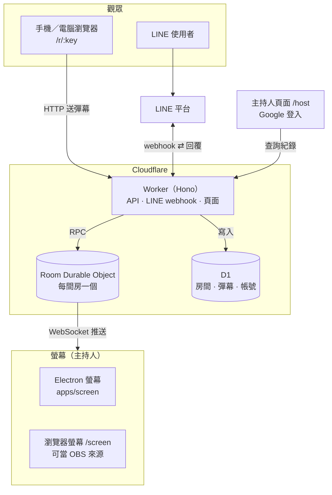

# 架構

[← 回到 README](../README.md)

一則彈幕的路徑：觀眾從網頁或 LINE 送出 → Worker 驗證並寫入 D1 → 交給該房間的 Durable Object → 透過 WebSocket 推到所有連線中的螢幕（沒有螢幕連線時先排隊，連上後補送）。所有連線都是「用戶端 ↔ Cloudflare」，沒有瀏覽器之間的 P2P。

圖中省略的細節：螢幕啟動時先呼叫 `POST /api/rooms` 開房；Durable Object 在開房 3 小時後以 alarm 自動關房並更新 D1；瀏覽器端的 JS 與字型由 Workers 靜態資源提供；主持人登入走 Google OAuth。

## 元件

| 位置                   | 內容                                                                                                                                          |
| ---------------------- | --------------------------------------------------------------------------------------------------------------------------------------------- |
| `apps/worker`          | Cloudflare Worker（Hono）：API、LINE webhook、觀眾／主持人頁面（Hono JSX）、瀏覽器螢幕、Room Durable Object、D1 migrations                    |
| `apps/screen`          | Electron 螢幕：疊在簡報上的透明視窗 + 控制面板（從 [danmu-classroom-screen](https://github.com/danmu-classroom/danmu-classroom-screen) 搬入） |
| `packages/screen-core` | 兩種螢幕共用：`ScreenConnection`（開房、WebSocket、斷線重連、房間關閉後自動開新房）、`DanmuCanvas`（彈幕繪製）、加入連結與 QR code、字型      |
| `packages/shared`      | API 與 WebSocket 訊息的共用型別                                                                                                               |

- **Room Durable Object**：一間房一個。螢幕用 hibernatable WebSocket 連線，彈幕即時推送；沒有螢幕連線時先排入佇列，螢幕連上後補送。開房 3 小時後由 alarm 自動關房。也負責公開 API 的頻率限制（每位發送者 token bucket：一次最多 3 則，之後約每秒 1 則，超過回 429；LINE 不受限）。
- **D1**：房間、彈幕紀錄、發送者與 LINE bot 對話狀態、主持人帳號與 session。房號只在「開放中的房間」之間唯一，由 partial unique index 保證。
- **觀眾網頁** `/`、`/r/:key`：不用登入；瀏覽器產生匿名 ID 存在 localStorage，以 `provider: "web"` 送出。
- **瀏覽器螢幕** `/screen`：背景透明，`?bg=` 設純色背景、`?qr=0` 隱藏加入 QR code。在已登入的瀏覽器開啟時，房間自動歸到該主持人。

## 為什麼不用 WebRTC／瀏覽器 P2P

所有連線都經過 Cloudflare（觀眾 HTTP → Worker → Durable Object → WebSocket → 螢幕），而不是讓觀眾的瀏覽器直接連到螢幕。原因：

1. **P2P 省不掉伺服器**：WebRTC 需要信令伺服器交換連線資訊（觀眾也得先靠伺服器用房號找到螢幕），還需要 STUN／TURN 穿越 NAT。學校、公司與活動場地的網路常擋 P2P，最後只能走 TURN 中繼，比現在的做法更貴更複雜。
2. **LINE 一定要經過伺服器**：LINE webhook 是呼叫公開的 HTTPS 網址，無法連到教室裡的瀏覽器。
3. **使用情境不適合**：很多觀眾對一台螢幕，P2P 要維持 N 條連線；手機觀眾來來去去，每次建立連線要一兩秒；螢幕斷線時伺服器能排隊補送，P2P 斷了訊息就沒了。
4. **有些功能只有伺服器做得到**：彈幕紀錄與 CSV、主持人帳號與房間歸屬、觀眾碰不到的防洗版限速、房號配發。
5. **伺服器成本接近零**：彈幕是短文字、流量極小；Durable Object 閒置時休眠不計費，免費額度就夠用。

若之後要加觀眾麥克風、視訊這類**影音**互動（流量大、要低延遲），才值得用 WebRTC；屆時仍需信令與 TURN，可搭配 Cloudflare Realtime。完全沒有網路的場地，較實際的做法是現場放一台區域網路伺服器，而不是 P2P。

## 主持人帳號

主持人用 Google 登入（`/login`，OAuth 2.0 authorization code + PKCE，使用 [arctic](https://arcticjs.dev/)），之後可在 `/host/rooms` 看自己的房間和彈幕紀錄。房間歸屬：

- 在已登入的瀏覽器開 `/screen`：開的房間自動歸到這個帳號。
- Electron：控制面板按「保存到我的帳號」，會用房間的 `auth_token` 換一個 10 分鐘有效的一次性連結（`POST /api/rooms/:key/claim-codes`）並開啟瀏覽器，主持人登入後在 `/host/claim` 確認。

Session 存在 D1（只存 token 的 SHA-256），cookie 為 HttpOnly、SameSite=Lax，30 天有效；表單 POST 有 CSRF（Origin）檢查；登入後的導向只允許站內路徑。登入方式集中在 `apps/worker/src/auth/providers.ts`，要加 LINE、GitHub、Microsoft 只需新增一筆設定。

## LINE bot

對話流程與舊版相同：先按「輸入房號」→ 輸入螢幕上的房號 → 之後傳的每則訊息都會變成彈幕，並可「換個房間」或「離開房間」。`X-Line-Signature` 以 Web Crypto HMAC-SHA256 驗證；回覆直接呼叫 Messaging API（不使用 SDK），回覆失敗只記 log、webhook 仍回 200。對話狀態存在 D1 的 `senders`。

## API

| Method | Path                                 | 說明                                                                                                                 |
| ------ | ------------------------------------ | -------------------------------------------------------------------------------------------------------------------- |
| `POST` | `/api/rooms`                         | 開房，回傳房號與 `auth_token`（只回傳這一次）                                                                        |
| `GET`  | `/api/rooms`                         | 開放中的房間                                                                                                         |
| `GET`  | `/api/rooms/:key`                    | 單一房間                                                                                                             |
| `POST` | `/api/rooms/:key/danmus`             | 送彈幕 `{ "danmu": { "content": "...", "sender": { "provider": "web", "uid": "..." } } }`                            |
| `GET`  | `/api/rooms/:key/ws?auth_token=`     | 螢幕的 WebSocket：收到 `{ "type": "danmu", "danmu": {...} }` 與 `{ "type": "room_closed" }`；送 `ping` 會收到 `pong` |
| `GET`  | `/api/rooms/:key/danmus?auth_token=` | 輪詢（相容舊版螢幕），取出並清空佇列                                                                                 |
| `POST` | `/api/rooms/:key/claim-codes`        | 用 `auth_token` 換一次性連結，把房間加到主持人帳號                                                                   |
| `POST` | `/api/line/callback`                 | LINE Messaging API webhook                                                                                           |

頁面：`/`、`/join`、`/r/:key`（觀眾）、`/screen`（瀏覽器螢幕）、`/login`、`/auth/:provider`、`/logout`、`/host/rooms`、`/host/rooms/:id`、`/host/rooms/:id/danmus.csv`、`/host/claim`（主持人）。

房間與彈幕 API 的回應格式與舊版 Rails API 相同。
